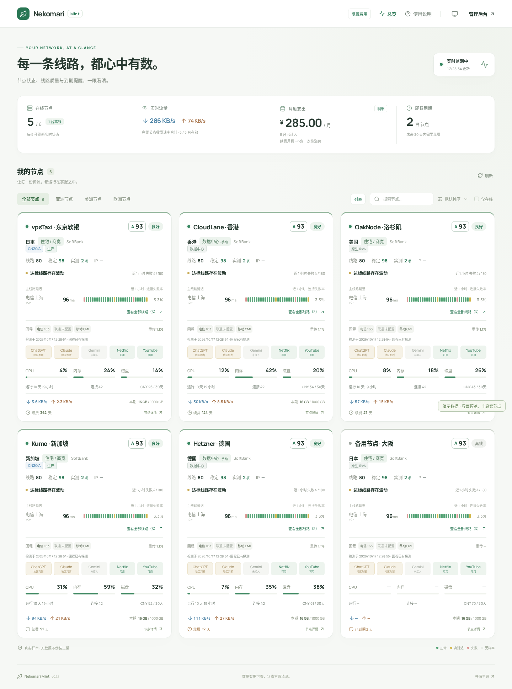

# Nekomari Mint

薄荷绿的 Komari / Nekomari 监控主题，采用圆角信息卡、真实时间桶历史条和响应式布局。
按参考界面实现，但不把未检测的功能画成已经正常工作。

[下载最新主题包](https://github.com/Aone2233/komari-theme-nekomari-mint/releases/latest)
· [安装与配置](docs/INSTALL.md)
· [数据与限制](docs/DATA.md)
· [主题商店申请材料](docs/STORE-SUBMISSION.md)



## 已实现

- 节点在线状态、CPU / 内存 / 磁盘、收发速率、到期提醒、按设置汇率折算月度支出。
- 费用明细与管理员可视化编辑：逐节点人民币溢价 / 折价、固定期或 SAO 口径月摊、排除节点及汇率快照来源。
- 搜索、分组、仅在线筛选、排序、详情弹窗、浅色 / 深色模式、320px 起的移动端布局。
- 外观支持跟随系统 / 浅色 / 深色，默认随操作系统实时切换；顶栏外观图标可选择并记住当前浏览器偏好。
- 实际延迟任务的一小时历史、失败比例、协议 / 地址族区分；参考目标不混入主目标评分。
- 首页每张卡片只展示一条主线路，可按节点指定或设置全局优先任务；点开详情查看全部线路，不因主线路失败自动换线。
- 后台管理式主题设置、私有站点登录（含两步验证码）、保留原有管理后台。
- 可选 Nekomari 扩展：服务检测证据、回程 ASN 标签、Linux TCP 重传、本期流量、网络摘要。
- 0.2.0：卡片 / 列表切换、彩色标签、运行时间 / 连接数、CPU / 吞吐排序和默认隐藏费用。
- 详情按需加载 1 / 6 / 24 小时资源历史；区分面板待升级、Agent 未上报、未配置和检测过期。
- 详情处理器能力说明：公开规格、定性用途区间与来源链接，区分分配的逻辑 CPU 和整颗规格；[目录与边界](docs/CPU-GUIDE.md)。
- 节点详情分为概览 / 资源历史 / 线路观测 / 检测依据，固定标题与关闭按钮；历史图表按需加载，离开分区暂停请求。
- 详情多线路延迟折线图：近 1 / 6 / 12 / 24 小时及自定义日期区间、全选 / 全不选、悬停 / 触控时间轴、失败标记、最新 / 最小 / 最大 / 平均 / P95 和实际返回范围；首页仍保留一小时时间桶历史条。
- 区分 ICMP 丢包率、TCP 连接失败率和 HTTP 请求失败率；每条线路至少 30 个返回记录且最新记录在五分钟内才参与评级，未达标仍保留失败证据。
- 网络类型优先保留明确的管理员类别标签并标“手动”；自动分类缺失不盖掉家宽 / 教育网，详情可查看分类依据。

## 安装

1. 在 Release 下载 **`nekomari-mint.zip`**，不要下载 GitHub 的 Source code ZIP。
2. 在 Komari / Nekomari 管理后台的主题页导入 ZIP，再启用 **Nekomari Mint**。
3. 打开 **Mint 主题设置**，选择主线路 / 三网任务，按需填写汇率、溢价与首页文案。
4. 首页先“显示费用”，再打开月度支出“明细”，管理员可逐节点编辑溢价 / 日期 / 摊销月数。

无需独立 Web 服务、数据库或公网 API token。浏览器仅访问当前面板同源 API；字体随包提供。
按站点根路径 `/` 部署；反向代理子路径暂不声明支持。
已有 SAO 配置可离线准备迁移方案，保留原溢价、收购价与逐节点线路绑定；见安装文档。
迁移工具不连接生产、不自动写入服务器，也不把用户账单或汇率固化进主题包。

## 兼容性

| 环境                                        | 状态                                                  |
| ------------------------------------------- | ----------------------------------------------------- |
| 官方 Komari 1.6.0 + 官方 Agent 1.5.11       | 已真实部署、导入、采样及浏览器验证                    |
| Nekomari `main`（含 Mint 扩展）+ 对应 Agent | 已真实部署并验证资源、延迟、本期流量与检测快照        |
| 旧 Komari 或其他 fork                       | 未逐版本验证；需要 `/api/rpc2` 及本主题使用的公共方法 |

官方 Komari 没有 `public:getNodeInsights` 时自动降级，节点监控仍可用。扩展能力不会
凭空出现：回程默认不探测，新版 Agent 支持 Gemini 页面证据，IP 信誉不评分，AI 地区判断不等于 IP 解锁。
官方版本缺少可信本期流量字段时显示“未上报”，不冒用开机以来的网卡累计值。

扩展端的实现及安全边界见
[Nekomari 文档](https://github.com/Aone2233/Nekomari/blob/main/docs/MINT-THEME.md)。
导入主题本身不会替换生产服务端或更新 Agent。

## 本地开发

需要 Node.js 22、npm、Python 3（打包用）；浏览器测试需要 Playwright Chromium。

```bash
npm ci
npx playwright install --with-deps chromium
npm run dev
npm test
npm run test:browser
npm run package
```

开发地址 `http://127.0.0.1:5174`，API 默认代理到 `http://127.0.0.1:25775`；请只连接
隔离开发实例，配置见 `vite.config.ts`。不要把生产 token 或密码放进前端环境变量。

产物在 `releases/nekomari-mint.zip`，校验和在 `releases/SHA256SUMS.txt`。
ZIP 根目录包含 `komari-theme.json`、`preview.png`、`LICENSE`、`dist/`，没有源代码测试夹具、
运行时数据库或账号文件。打包脚本固定条目顺序和时间戳，同一构建输入产生相同 ZIP。

测试中的节点、运营商和路由是**明确标注的演示夹具**，只用于测试 / 预览，不打包到页面中。
普通浏览器测试将截图写入测试产物；`npm run screenshots` 才更新仓库预览。
`scripts/smoke.mjs` 可验证已安装主题的真实实例，见安装文档。

## 发布

`main` 推送自动测试；推送与清单版本一致的 `vX.Y.Z` 标签后，CI 重新运行测试、构建、
验证 ZIP 与 SHA-256，再上传 Release。主题更新不要求更新 Nekomari 服务端。
后端扩展发版及可能的 Agent 自动升级应另行安排。

## English

A self-contained mint-green monitoring theme for Komari and Nekomari. Import the
release asset `nekomari-mint.zip` in the existing administration panel. Official
Komari 1.6.0 is tested; optional Nekomari insights degrade gracefully when absent.
Unknown measurements remain unknown, region evidence is not advertised as an
IP-level unlock, and no reputation score is fabricated. UI language is currently
Simplified Chinese. No external frontend service or API token is required.

## License and credits

MIT, Aone2233. Built with React, Vite, Lucide and Manrope (their respective
licenses remain applicable; see `docs/THIRD-PARTY.md`). Compatible with
[Komari](https://github.com/komari-monitor/komari) and
[Nekomari](https://github.com/Aone2233/Nekomari); not an official Komari project.
Operational controls and cost/premium separation are inspired by
[Komari-Theme-SAO](https://github.com/WAOR/Komari-Theme-SAO) (MIT);
implemented independently for Mint without copying its source or artwork.
